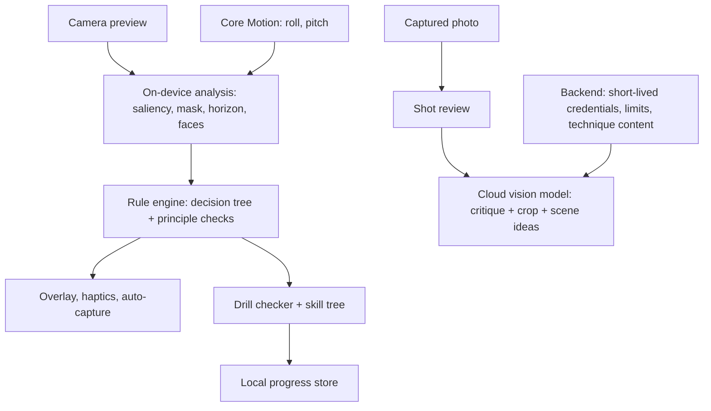

# FrameCoach — Composition Coach for Phone Photography

*Last updated: 2026-11-10 12:08 PM*

> A camera that teaches composition. Live overlays guide the photographer behind the phone — placement, horizon,
> lead room, edges, background — then drills and shot reviews train the eye until the overlays are no longer needed.
> Sibling of [PoseCoach](pose-coach-spec.md): PoseCoach directs the people in front of the lens; FrameCoach directs the person behind it.

- Working name only — `FrameCoach` is unchecked for trademarks and store collisions.
- Content source: the composition knowledge base in 10x-ws, `context/domains/external/world/hobbies/mobilography/mob-knowledge.md`
  (principles P1–P9, technique catalog A–M, decision tree, exercises). The rule engine and drills below map to it.
- Status: idea stage. No prototype, benchmark or user test exists; every number below is a proposal.

---

## 1. Problem

- Phone cameras solved exposure and focus; composition stays the gap between a snapshot and a photo.
- The phone gives a grid and a level, nothing that says *why* a frame fails or *what* to change.
- YouTube and courses teach rules away from the scene; the lesson is gone when the phone comes out.
- Beginners repeat the same 8–9 mistakes (subject centered without symmetry, no lead room, cut-off subject,
  no foreground anchor, cluttered background, standing eye-level) — `mob-knowledge.md` P1–P9.
- Most of those mistakes are measurable on the live frame, so a camera can catch them before the shutter.

---

## 2. Concept — 4 modes

### 2.1 Live coach (in the camera)

- Detect the subject and the scene, then pick 1–2 fitting techniques from the decision tree (symmetry → center,
  strong line → leading lines, clean space → negative space, fallback → thirds).
- Overlay one target and one correction at a time: a target point (thirds or phi), a level bar, a lead-room arrow,
  an edge-cut warning, a clutter highlight on the background.
- Confirm a hit with a haptic tick and a green target; optional auto-capture burst once the frame holds.
- Speak nothing by default — the photographer looks at the screen, so overlays beat voice; voice stays optional.

### 2.2 Shot review (after the shot, or any camera-roll photo)

- Score a photo per principle (placement, horizon, edges, subject clarity, background, space) and name the top 1–2 fixes.
- Propose a re-composed crop and show before → after.
- Explain in one sentence, linked to the technique card — the review teaches, not only grades.
- Import old photos for a "what's wrong with my last 50 shots" report: the most frequent mistake becomes the next drill.

### 2.3 Drills (training)

- Turn each `mob-knowledge.md` exercise into a drill with a measurable pass check:
  negative space → subject mask ≤ 20% of frame; rule of thirds → subject centroid within the intersection zone;
  5-angle ladder → 5 frames with distinct camera pitch; foreground anchor → depth or saliency in the lower third.
- Verify each frame locally; a drill completes at N passing frames, not N taps.
- Progress through the skill tree (Tier 1 vision → Tier 2 light → …); unlock techniques as drills pass.
- Fade the coach: as a technique's pass rate rises, its overlay shrinks, then turns off — the goal is an eye that no longer needs it.

### 2.4 Technique library

- One card per catalog technique (A–M): definition, when to use it, 2–3 example photos, the drill that trains it.
- Use original or licensed example photos only — shoot them during dogfooding.

---

## 3. FrameCoach vs PoseCoach

| Dimension | PoseCoach | FrameCoach |
|---|---|---|
| Who gets coached | People in front of the lens | The photographer behind it |
| User's attention | Subjects can't see the screen → voice | Photographer watches the screen → overlay + haptics |
| Subject | Humans only | Any scene: people, pets, streets, landscapes, objects |
| Core signal | Body keypoints vs a reference pose | Saliency, subject mask, horizon, face yaw, device motion |
| Cloud need | Realtime voice + frames during the shoot | Sparse: shot reviews and scene ideas only |
| Cost per session | Engineering target $0.10–$0.50 per 5-min shoot | Live coach ≈ $0 (on-device); reviews per image |
| Works offline | Degraded | Live coach and drills fully; reviews need network |
| Retention driver | New poses and trends | Skill progression and drills |

- The September [photo director analysis](ai-photo-director-market-analysis.md) lists composition (camera position,
  distance, background, crop) as one of the 5 parts of creativity and "set_camera" as a session state.
  FrameCoach's engine is that part, built standalone — a later photo director can reuse it for people shoots.

---

## 4. Competition

Researched 2026-11-10 from official pages, App Store listings and reviews. Features are advertised claims; no app was tested.
Rating counts show traction signals only — downloads and revenue stay unknown.

### 4.1 Built into the phone

| Product | Does | Reach | Link |
|---|---|---|---|
| Google Pixel Camera Coach | Gemini tips on framing, mode, angle, light before the shot; cloud, needs a connection | Pixel 10 Pro per Google (sources conflict on Pixel 10); launched 2025-09 | [Google](https://blog.google/products/pixel/how-to-use-camera-coach/) |
| Samsung Shot suggestions | Detects the subject, shows a target circle to align; off by default | Galaxy S10-era devices; presence on current One UI unverified | [Samsung](https://www.samsung.com/uk/support/mobile-devices/how-to-use-shot-suggestions/) |
| Huawei AI composition | On-device dot-and-ring framing guidance, portrait angle hints | Pura 80/90, nova 14; details from news sites, unverified | [HuaweiCentral](https://www.huaweicentral.com/huawei-pura-80-update-bring-new-ai-portrait-shooting-angle-feature/amp/) |
| Oppo AI Recompose | Post-shot auto re-crop, no coaching | ColorOS 15 models | [Oppo](https://support.oppo.com/eg-en/answer/?aid=neu117) |
| Apple Camera (iOS 26) | Grid and level only; an iOS 27 composition-UI claim has a single source | Every iPhone | [9to5Mac](https://9to5mac.com/2025/10/30/ios-26s-camera-app-hides-key-features-heres-how-to-find-them/) |

### 4.2 Third-party iOS apps

| App | Mode | Does | Price | Ratings | Link |
|---|---|---|---|---|---|
| GudoCam | Live + review | Live guides (placement, zoom, exposure, angle), composition catalog overlays, AI review scores, weekly challenge, photographer tiers | Free; $4.99/mo, $39.99/yr; Ultimate $79.99/yr | 1 | [App Store](https://apps.apple.com/us/app/id6759212077) |
| Klick | Live + review | Thirds / center / symmetry placement prompts; ShotKit calls it "geometric rather than aesthetic" | $2.99–$4.99/wk, $24.99–$39.99/yr, $99.99 lifetime | 2 | [App Store](https://apps.apple.com/app/id6749798728) |
| SnapFrame | Live | On-device Apple Vision; 1–5 composition score; thirds, center, leading lines, symmetry, horizon | $3.99 one-time | too few to show | [App Store](https://apps.apple.com/app/id6773542560) |
| LensMentor | Live | AI framing and crop suggestions, leveling, pose guide | Free + IAP | 2 | [App Store](https://apps.apple.com/app/id6758041620) |
| WayShot | Live | Dot-and-ring angle guide, voice pose tips | not stated | press coverage 2026-01 | [Dead Pixels Society](https://thedeadpixelssociety.com/wayshot-launches-ai-photography-app-with-real-time-coaching/) |
| PostFrame | Post + re-shoot | Reframes a photo, explains, overlays the target for a re-shoot | $4.99/wk, $39.99/yr | 10 | [App Store](https://apps.apple.com/app/id6749789133) |
| Focal | Post | 1–10 scores on composition, light, focus, story; next challenge | Free; $4.99/mo | none shown | [App Store](https://apps.apple.com/app/id6764394955) |
| 365Frames | Post, learning | Daily AI challenges, lessons, quizzes, streaks, leaderboards | Free + IAP | 1 | [App Store](https://apps.apple.com/us/app/365frames/id6740530398) |

- More post-shot critics (VAZOYO, Evalens, ShutterCoach) sell credit packs; Android has only Pixel plus a Play challenge app
  ([Photo Challenge](https://www.coddykit.com/apps/photo-challenge)).
- Courses (iPhone Photography School) sell video lessons at ~$49–$99 one-time, with no in-camera check.

### 4.3 Reading

- The category exists on iOS: 5+ live composition coaches and as many post-shot critics shipped in 2025–2026.
- No app shows traction: every listing has 0–10 ratings, so no winner and no demand proof exists.
- GudoCam already advertises most of FrameCoach's surface — live guides, catalog, reviews, challenges, tiers.
- Features alone won't differentiate; guidance quality and distribution decide.
- Pixel Camera Coach is the only large player, and it doesn't reach iPhone.

---

## 5. Where it can win

- **Guidance quality.** Pick the technique per scene (decision tree), gate nudges on confidence, explain the principle;
  the one reviewed competitor is called geometric, not aesthetic. Prove it head-to-head in #10.
- **Measured learning.** No competitor advertises skill transfer; FrameCoach tracks coach-off improvement as its core metric.
- **Drills checked live.** Competitor challenges score a finished photo; FrameCoach verifies drill criteria in the viewfinder, before the shot.
- **Coach fade.** Overlays retire per technique as pass rates rise — the product promise is an eye that needs no app.
- **Zero marginal cost for the core loop.** Live coach and drills run on-device, so a free tier costs nothing to serve.
- **Distribution from the hobby.** The founder's mobilography journey supplies dogfood, example photos and
  learning-in-public content (ventures `content-creation`) — the channel the 0–10-rating competitors lack.

---

## 6. What the phone can measure

Rule engine inputs, mapped to `mob-knowledge.md`. Confidence is an engineering guess until the spike measures it.

| Principle / technique | Signal | iOS source | Confidence |
|---|---|---|---|
| Horizon level (catalog C, L) | Horizon angle + device roll | [`DetectHorizonRequest`](https://developer.apple.com/documentation/vision/detecthorizonrequest), Core Motion | High |
| Subject placement — thirds / phi (P2, A) | Subject centroid vs target points | [Attention](https://developer.apple.com/documentation/vision/generateattentionbasedsaliencyimagerequest) / [objectness](https://developer.apple.com/documentation/vision/generateobjectnessbasedsaliencyimagerequest) saliency, [`GenerateForegroundInstanceMaskRequest`](https://developer.apple.com/documentation/vision/generateforegroundinstancemaskrequest), human/animal detection | Medium-high |
| Cut-off subject (P3) | Subject mask touches the frame border | Foreground / person mask | Medium-high |
| Edge crowding (P6) | Subject margin to nearest edge below threshold | Subject bounding box | High |
| Lead room / gaze (P1) | Face yaw → space on the facing side | `VNDetectFaceRectanglesRequest` yaw | Medium (faces); low (animals) |
| Negative space (F) | Subject area / frame area | Subject mask | High |
| One subject (P4) | Count of salient objects of comparable weight | Attention / objectness saliency | Medium |
| No subject — view only (P5) | No strong salient object + horizon present | Saliency + horizon | Medium |
| Background clutter (P8) | Saliency mass outside the subject; distinct objects behind it | Saliency map minus subject mask | Medium |
| Perspective — get lower (P7) | Pet or child detected while the phone points down | Animal / human detection + device pitch | Medium |
| Symmetry → center (P2, B) | Mirror difference around the vertical axis | Custom image diff | Medium |
| Leading lines (C) | Lines converge near the subject | Contour / line detection (custom) | Low-medium — v2 |
| Layers / foreground anchor (G) | Near content in the lower frame | Depth (`AVDepthData`, LiDAR on Pro) | Medium, device-dependent — v2 |
| Backlight (Light tier) | Face far darker than background | Face rect luminance vs frame | Medium |
| Keeper ranking | Aesthetic score per frame | [`CalculateImageAestheticsScoresRequest`](https://developer.apple.com/documentation/vision/calculateimageaestheticsscoresrequest) `overallScore`, `isUtility` | Medium — general aesthetics, not composition |

- The Swift request APIs above need iOS 18; older `VN…` class equivalents exist for earlier versions.
- Start with the 6 high/medium-high rows; they cover P1, P2, P3, P6 and negative space.
- Treat every overlay as a suggestion with a confidence gate — a wrong nudge costs more trust than a missing one.

---

## 7. Architecture

- Run local analysis at a target 10–15 Hz, throttled by heat; never stream frames to the cloud in live mode.
- Keep the rule engine deterministic and testable: each rule returns `{principle, verdict, confidence, hint}`.
- Call the cloud model only on a review or a "suggest an idea for this scene" tap — one image, short structured output
  mapped to principle IDs.
- Choose the vision model by a spike benchmark: agreement with blind human ratings on ~100 labeled photos, plus cost per review.
- Stack: native Swift/SwiftUI, AVFoundation, Vision, Core Motion, PhotoKit — the same base the photo director analysis recommends.
- Backend: a small .NET service for credentials, quotas and technique content; photos stay on the device unless the user opts in.

---

## 8. MVP scope (iOS only)

- Live coach with 6 rules: horizon, thirds/phi placement, cut-off, edge crowding, lead room (faces), negative space.
- 5 drills from the starred exercises: rule of thirds, negative space, gaze room, 5-angle ladder, 5-foot shuffle.
- Shot review on camera-roll photos with crop suggestion.
- Technique library: 10 cards (the MVP rules + their drills).
- No accounts, no social features, no Android.

### Build sequence

| Stage | Estimate | Gate |
|---|---|---|
| Spike | 1–2 weeks | 6 rules on a live preview at target rate; overlay feels stable, not jittery |
| Dogfood | 2–3 weeks | Founder shoots daily with it; rule false-positive rate logged per rule |
| Drills + review | 2–3 weeks | 5 drills verify frames correctly; review names the right top fix on a labeled set |
| Pilot | 2 weeks | 10 hobbyists, 2 weeks each — see #10 |

- Estimates assume 1 iOS engineer part-time; total roughly 7–10 weeks, conditional on the spike.

---

## 9. Monetization (hypotheses)

- Free: live coach + level + 3 drills — costs nothing to serve, so it can be generous.
- Paid: full skill tree, all drills, shot reviews with a monthly allowance.
- Test a one-time unlock for local features against a subscription that carries reviews — cloud cost is per review,
  so a lifetime price covers only the local part.
- Anchors from #4: $24.99–$39.99/yr subscriptions, $3.99 one-time (SnapFrame), $99.99 lifetime (Klick), ~$49–$99 per video course.
- Avoid weekly plans — they fit one-off use, while FrameCoach sells progression over months.

---

## 10. Validation

- Before building: shoot 1 week each with SnapFrame, GudoCam and Klick; log every wrong or missing nudge.
  If one already coaches well, use it for the hobby and park FrameCoach.
- Dogfood: 4 weeks of the founder's own shooting, before/after sets rated blind by 3 people.
- Pilot: 10 phone-photography hobbyists, 2 weeks, half with drills, half with the live coach only.
- Compare first-week vs last-week photos in a blind rating, app labels hidden.
- Track: drills completed, coach-on vs coach-off shots, return after day 7, offers taken.

Suggested pilot targets, not statistical proof:

- At least 7 of 10 participants' last-week sets rate higher than their first-week sets.
- At least 5 of 10 still shoot with the app in week 2 without reminders.
- Coach-off shots in week 2 keep at least half of the coached improvement — proof the eye learned, not the overlay.

---

## 11. Risks and open questions

- **Teacher churn.** A coach that works makes itself unnecessary; retention needs depth beyond the basics
  (catalog has ~55 techniques, light and genre tiers) or a community/challenge layer.
- **Wrong nudges.** Saliency picks the wrong subject in busy scenes; one bad "move left" breaks trust — gate on confidence, let the user tap the subject.
- **Rules vs taste.** Rule-following frames can be dull; breaking rules on purpose must stay possible — a "rule off" toggle per principle.
- **Platform risk.** Apple can ship composition hints in Camera; Google already ships Camera Coach on Pixel — the drill/skill layer must be the moat.
- **Custom camera quality.** A third-party camera may not match Apple Camera processing; measure output against it in the spike.
- **Overlay clutter.** Several warnings at once overwhelm; show one correction at a time, prioritized.
- OQ-1: one app with PoseCoach as a mode, or a standalone product? Decide after the spike — the engine is shared either way.
- OQ-2: is the buyer a hobbyist learner (drills) or a casual shooter (live fix)? The pilot's split answers it.

---

## Verdict

- **Promise:** solid as a learning product — composition rules are measurable, and the curriculum already exists.
- **Market:** crowded and unproven — 10+ indie iOS apps, none with traction; GudoCam covers most features.
- **Defensibility:** low for overlays and features; medium for guidance quality, measured learning and a content channel.
- **Effort:** low-medium — on-device APIs cover the MVP rules; the cloud part is a sparse review call.
- **Likely failure mode:** one more indie composition camera with 2 ratings — distribution, not features, kills it.
- **First test:** a week each with SnapFrame, GudoCam and Klick; build only where they demonstrably fail.
  Then the 6-rule spike plus 4 weeks of dogfooding; if blind-rated photos don't improve, drills and reviews won't save it.
