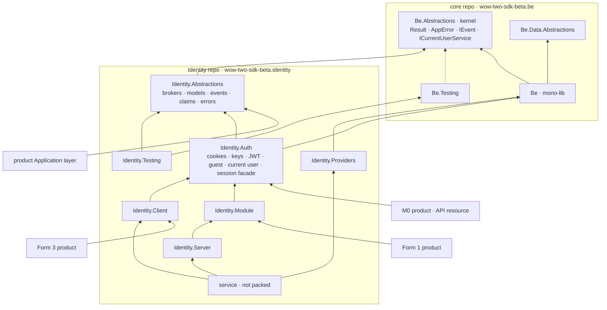

# T7 — Identity library architecture

*Last updated: 2026-10-25*

> Identity leaves the be sdk whole, as seven packages over one `Identity.Abstractions` contract; the main SDK
> references a kernel `WoW2.Sdk.Beta.Be.Abstractions` in its own repo, because an abstractions package published
> from the Identity repo would close a cycle through `Result`, `AppError` and `IEvent`.

- Aliases `be`, `fe` as in [T3](t3-code-and-consumers.md); modes `M0`–`M13` from [T4](t4-integration-modes.md); `(U)` = unverified.
- Facts come from reads and greps of `be`, `fe` and the product trees on 2026-10-25; nothing was built or edited.
- The placeholder layer names in [T8](t8-library-template.md) map to §1.

---

## Verdict

- **Go, with one change to the developer's cut:** the main SDK references a kernel `WoW2.Sdk.Beta.Be.Abstractions` in the core repo, not `Identity.Abstractions`; the Identity contract needs `Result`, `AppError` and `IEvent` from core, so the literal cut is a package cycle.
- Core reads two identity types only, `ICurrentUserService` and `UserKind` (BCL-only); they go to the kernel, and the rest of `Identity/` (259 files, ~11.3k LOC, all 27 identity NuGet refs) leaves core, T5's primitives included.
- Identity ships 7 NuGets: `Abstractions` (kernel only) · `Auth` · `Module` · `Client` · `Providers` · `Server` · `Testing`; Form 1 takes Module, Form 3 Client, M0 products and API resources Auth.
- Pattern: core references only the kernel; a domain package references its own contract, core and lower-tier contracts; releases flow core → Identity → File Storage → Events/Harvest → products. File Storage passes.
- fe needs no abstractions package (`@wow-two-beta/fe/auth` already is the seam); products make 0 `using` edits and one re-pin commit each.

---

## 1 · Layer model

| # | Layer | Package pattern | Holds | May reference |
|---|---|---|---|---|
| K | kernel | `WoW2.Sdk.Beta.Be.Abstractions`, beside the existing `…Be.Data.Abstractions` | value types every contract uses; interfaces core's own code reads | BCL only |
| C | core | `WoW2.Sdk.Beta.Be` | infra: Web, Data, Mediator, Http, Caching, Comms, Observability | K |
| 1 | contract | `…Be.{Domain}.Abstractions` | brokers, models, `IEvent` records, constants, error catalogue and its texts | K |
| 2 | edge | `…Be.Identity.Auth`, `…Be.FileStorage.Blobs` | the store-less part a product uses without the domain's store or service | 1, C |
| 3 | forms | `…Be.{Domain}.Module` · `…Be.{Domain}.Client` | Form 1 implementation · Forms 2/3 HTTP client and receivers | 2, 1, C, lower-tier contracts |
| 4 | extensions | `…Be.{Domain}.Providers` · `…Be.{Domain}.Server` | opt-in heavy adapters; the protocol host the service runs | 3 or C |
| T | test kit | `…Be.{Domain}.Testing` | fakes over the contract, personas, conformance base | 1, `…Be.Testing` |
| S | service | not packed | host, admin, hosted pages, Dockerfile | own packages by `ProjectReference`; lower-tier Client or Auth |

- References point to a lower row; nothing references sideways except forms → edge.
- Core references K only, never rows 1–4 of any domain.
- The contract has no `FrameworkReference` and no third-party package, so `HttpContext`, `DbContext`, OpenIddict and EF types cannot enter it.
- That makes [swappable modules](../../conventions/development/swappable-modules.md) § Contract ("vendor types out of the contract") a compiler fact.
- Rows 2–4 add `<FrameworkReference Include="Microsoft.AspNetCore.App" />`; without it restore hits NU1109 (be sdk companion lesson).
- The edge is optional: a domain has one only when products use part of it with no store.
- Extensions exist only where they isolate heavy deps or a server role.
- Product `Domain` and `Application` projects reference row 1 only; the composition root (`Api`, `Infrastructure`) picks one row-3 package.
- T4's precondition "product code never reads identity tables" becomes a project-reference fact, not only an architecture test.
- Developer's words: "abstractions" = row 1, "core" = row 3; the Form 1 package keeps T5's name `Module`, since "core" names the main SDK.

---

## 2 · Where cross-domain seams live

### What the contract needs from core

- T4 § Contract: brokers return `Result` / `Result<T>` with an `AppError` from an Identity catalogue; the 7 events are `IEvent` records.
- `Result` carries `AppError` (`Foundation/Results/Result.cs:1` imports `Foundation.Errors`).
- `AppError` imports `Ardalis.GuardClauses` for two guards (`Foundation/Errors/AppError.cs:36`, `:49`).
- `IEvent` is a member-less marker (`Messaging/IEvent.cs`).
- All three compile into the mono-lib; its csproj excludes only Testing trees, tests, `Data/Abstractions` and the migrator CLI (`WoW.Two.Sdk.Beta.Be.csproj:34`).
- So core → `Identity.Abstractions` → core is a cycle; NuGet restore refuses it (NU1108).
- Today's Identity code barely uses them: `Foundation.Errors` in 2 files, `Foundation.Results` in 0, plus its own `IdentityResult` / `IdentityError` in `Core/`.
- The need comes from the T4 contract, not from the code that moves.

### What core needs back

- `ICurrentUserService.Id` and `.Kind`, injected as optional ctor parameters.
- Readers: `Data/EntityFrameworkCore/Audit/` (2 files), `SoftDelete/` (2), `Mediator/Idempotency/DeduplicatingInterceptor.cs`.
- `ICurrentUserService` and `UserKind` are BCL-only, 2 files, ~25 lines.
- The other core → Identity edges are strings: ru/uz texts in `Web/ErrorTranslation/FieldCodeMessageConstants.cs`, a doc comment in `Testing/Auth/TestClaimTypeConstants.cs`.
- M0 products with no Identity store (Wheelhouse, TranscriptForge) resolve the current user too, so the seam is request plumbing, not the Identity domain.

### Options

| | (a) core → `Identity.Abstractions` | (a′) (a) + a `Be.Foundation` package | (b) T5: primitives stay in core | (c) kernel in the core repo |
|---|---|---|---|---|
| Package cycle | yes: core → Identity.Abstractions → core (NU1108) | no | no | no |
| Repo cycle | yes | yes: core needs an Identity release, Identity needs core | no | no |
| Release order for an `ICurrentUserService` change | unbuildable | Identity → core → Identity | core → Identity | core → Identity |
| With 5 domain repos | — | core waits on every domain that contributes a seam | core keeps each domain's primitives | core waits on none |
| Leaves core | — | everything | 220 files; 41 files, 1,414 LOC and 3 refs stay | 259 files, 27 refs |
| Contract can hold vendor types | — | no | yes: Contracts sees the whole mono-lib | no |
| New packages in core repo | 0 | 1 | 0 | 1 |
| Product `using` edits | — | 0 | 0, or 39 files for honest names (T5 Open 2) | 0 |

- (a″) An `Identity.Abstractions` with its own result type avoids the cycle; it revives the two-model problem the errors redesign removed and breaks the T4 rule.
- **Pick (c).** It is (a′) without the reverse edge: the developer's abstractions package exists, and products and other domains reference it.
- Every later domain lands without touching core's references.
- The kernel has a consumer today: `Be.Testing` avoids core and mirrors the interface as `TestCurrentUser` / `TestUserKind` (`Testing/Auth/TestCurrentUser.cs` remarks).
- With the kernel, `TestCurrentUser` implements `ICurrentUserService` directly and `TestUserKind` retires.

### Kernel contents

| Types | From | Files | Why |
|---|---|---|---|
| `Result`, `Result<T>`, `Result<TSuccess, TFailure>`, `IResult`, 3 extension classes | `Foundation/Results/` | 5 · ~570 LOC | every broker returns them |
| `AppError`, `AppErrorType`, `AppErrorFactory`, `AppException`, `AppAggregateError`, `ErrorNature`, `ErrorOrigin`, `ErrorMessageConstants` | `Foundation/Errors/` | 8 · ~540 LOC | error catalogues are `AppError`s |
| `IEvent` | `Messaging/IEvent.cs` | 1 | domain events; frees contracts from the Messaging implementation |
| `ICurrentUserService`, `UserKind` | `Identity/CurrentUser/` | 2 | core Audit, SoftDelete and Idempotency read them |
| on demand: `FieldError`, `ValidationError`, `ValidationException`, `ValidationSeverity` | `Foundation/Validation/` | 4 | when a contract returns field errors |
| on demand: `PageDto<T>`, `TokenPageDto<T>` | `Web/Contracts/Paging/` | 2 | when `ListAsync` returns house pages |
| stays in core: exception mapper, mapping rules, nature mapper, their DI | `Foundation/Errors/` | — | DI, read by core only |

- Admission: a type enters the kernel only when core's own code or ≥ 2 repos' contracts need it, and it is BCL-only.
- BCL-only after swapping the two `Guard.Against.NullOrWhiteSpace` calls for `ArgumentException.ThrowIfNullOrWhiteSpace`.
- Moves keep namespaces, as `Data.Abstractions` kept `…Data.Dapper`; no product `using` changes.
- Core adds `[assembly: TypeForwardedTo]` per moved type, so binaries built against older core keep binding.
- The kernel versions in lockstep with core (package-layout § Versioning); products pin it through `BackendSdkVersion`.
- Churn risk is low: the errors model shipped 2026-06-23 and grows additively (`AppErrorType` members).

### Package graph

Arrows read "references"; every product also references core.

---

## 3 · Identity packages

| Package | Purpose | Key types | Heavy third-party deps | References |
|---|---|---|---|---|
| `…Identity.Abstractions` | the contract | 6 brokers (`IMemberBroker` …), models, `ActorModel`, 7 events, claim / route / scope constants, `IdentityErrorCodeConstants` + texts, org-claim readers | none | kernel |
| `…Identity.Auth` | store-less auth and the session facade | `AddCookieAuthentication`, `AddApiKeyAuthentication`, allowlist + default deny, guest session, `CookieCurrentUserService`, `AddJwtBearerAuthentication` + audience and org policies, HMAC `ITokenIssuer`, `AddIdentityIntegration`, `MapIdentitySession` | `Microsoft.AspNetCore.Authentication.JwtBearer`, `Microsoft.IdentityModel.JsonWebTokens`, `.Tokens` | Abstractions, core |
| `…Identity.Module` | Form 1 | `AddUserAccounts<TUser>`, slices, schema, `IdentityCore*Broker`, OTP + 5 channels, TOTP, passkeys, Argon2, `.AddModule(...)` | `Fido2.AspNet`, `Otp.NET`, `Konscious…Argon2`, `Telegram.Bot`; EF via core | Auth, core |
| `…Identity.Client` | Forms 2/3 | OIDC client, `.AddOidc(...)`, Refit `IIdentityManagementApi`, `IdentityApi*Broker`, logout and webhook receivers, revoked-sid store, opt-in projection | `…Authentication.OpenIdConnect`; Refit, Resilience, HybridCache via core | Auth, core |
| `…Identity.Providers` | upstream social sign-in | 17 OAuth wrappers, Google ID-token authenticator, claim normalizer | 14 `AspNet.Security.OAuth.*`, Microsoft Google / Facebook / MicrosoftAccount, `Google.Apis.Auth` | core |
| `…Identity.Server` | the OIDC server | OpenIddict server, keys + JWKS, client registry, back-channel sender, exchange grants | `OpenIddict.AspNetCore` + `.EntityFrameworkCore` 7.7.2 | Module |
| `…Identity.Testing` | fakes and conformance | fake brokers, personas, OTP code sink, fake instance, broker conformance base | none beyond `Be.Testing` | Abstractions, `Be.Testing` |

### Who references what

| Consumer | References | Arrives transitively |
|---|---|---|
| Form 1 product (M1: pilots; Haven and Desk until they move) | Module (+ Providers) | Auth, Abstractions |
| Form 3 product (M2/M3 BFF: ForeverPin, Ocharo apps) | Client | Auth, Abstractions |
| M0 product (Wheelhouse, TranscriptForge) | Auth (+ Providers) | Abstractions |
| API resource (M8: File Storage, Events, Harvest services) | Auth | Abstractions |
| product `Domain` / `Application` projects | Abstractions | kernel |
| another domain's packages | `Identity.Abstractions` only | kernel |
| Identity service | Module + Server + Providers + Client by `ProjectReference` | — |
| test projects | + Testing | — |

- A Form 3 product pulls OpenIdConnect, JwtBearer and 2 IdentityModel packages; none of OpenIddict, Fido2, Otp.NET, Argon2, Telegram.Bot, the OAuth set or `Google.Apis.Auth`.
- An M0 product pulls JwtBearer and IdentityModel through Auth; a separate Jwt package would spare 2 products 3 small packages, not worth a package.
- Products with no sign-in (Sift, Hijinx, Arcade, PoseCoach, others) drop all 27 identity packages from restore.
- The session facade (T4 option B) sits in Auth: `AddIdentityIntegration` reads `Identity:Mode`; Module adds `.AddModule(...)`, Client `.AddOidc(...)`.
- A configured mode whose package is absent fails at startup with a named error; that lets a Form 1 → 3 move delete the Module line and package (T4 Q3).
- Token validation sits in Auth, not Client: API resources validate offline with no OIDC client or brokers.
- OTP stays in Module: its store-less users (Haven, Desk) become clients of an instance, so an OTP package would lose its consumers.
- `CookieCurrentUserService` uses the `internal` `GuestCookieSerializer`, so CurrentUser's implementation and Guest move together.
- Introspection (M9), if it ever ships, is an extension over Auth carrying `OpenIddict.Validation`, never Auth itself.

### Reconciled with T4 and T5

| T4 | T5 | T7 | Reason |
|---|---|---|---|
| `Identity.Contracts` | Contracts, references core | `Abstractions`, references the kernel | developer's name; compiler keeps vendor types out |
| `Auth` primitives | stay in core | `Auth`, in the Identity repo | no core code imports them; namespaces need no rename |
| `Identity.Validation` | folded into Client | folded into Auth | `Jwt/` already holds bearer validation; M8 needs no Client |
| `Identity.Client` | Client | Client | — |
| `Identity.Client.Projection` | folded into Client | folded into Client, opt-in | EF arrives with core |
| `Identity.Module` · `Providers` · `Server` · `Testing` | same | same | — |

---

## 4 · What leaves the main SDK

| Path | Files · LOC | Disposition | Target |
|---|---|---|---|
| `Identity/Core/` | 140 · 6,940 | split: `IdentityErrorCodeConstants`, `OrganizationClaimTypeConstants`, `OrganizationClaimsPrincipalExtensions` (3 · 179, BCL-only); the rest | Abstractions; Module |
| `Identity/Otp/` · `Mfa/` · `PasswordHashing/` | 47 · 1,627 | move | Module |
| `Identity/OAuth/` · `Claims/` | 31 · 1,236 | move | Providers |
| `Identity/Oidc/` | 2 · 71 | move | Client |
| `Identity/Cookies/` · `ApiKeys/` · `Authorization/` · `Guest/` · `Jwt/` | 36 · 1,289 | move (T5: stay) | Auth |
| `Identity/CurrentUser/` | 5 · 125 | split: `ICurrentUserService.cs`, `UserKind.cs`; `CookieCurrentUserService`, options, registration | kernel; Auth |
| `Identity/IdentityApi/` · `Policies/` | 5 · 112 | delete: 0 consumers, 0 tests (T3) | — |
| `Web/ErrorTranslation/FieldCodeMessageConstants.cs` | 1 · 105 | split: a contribution seam stays; identity ru/uz texts leave | core; texts in Abstractions, registered by Module and Client |
| `Foundation/Results/` · `Foundation/Errors/` value types · `Messaging/IEvent.cs` | 14 | move, namespaces kept, forwarders in core | kernel |
| `Data/EntityFrameworkCore/Audit/`, `SoftDelete/`, `Mediator/Idempotency/DeduplicatingInterceptor.cs` | 5 | stay; resolve the kernel type with no edit | core |
| `Testing/Auth/` | 8 | stay; `TestCurrentUser` may implement the kernel interface | `Be.Testing` |
| `Http/Auth/` (client credentials, mTLS), `Web/Antiforgery/`, `Mediator/Authorization/` | — | stay: outbound auth and request plumbing | core |

- Totals: 259 files and ~11.3k LOC go to the Identity repo, 16 files to the kernel, 5 are deleted; `Identity/` disappears from core.
- The csproj loses 27 of 144 `PackageReference`s (`WoW.Two.Sdk.Beta.Be.csproj:150-176`).
- 26 of them move with the code; `Microsoft.AspNetCore.Identity.EntityFrameworkCore` leaves with `IdentityApi/` (T3).
- `Directory.Packages.props:162-163` drops the OpenIddict pins (still 6.0.0; Server pins 7.7.2, T1).
- Tests: all 95 methods of `Identity.Tests` move, T5's 33 "stay" methods included.
- Also moving: 2 tests in `Foundation.Tests/Comms/SmsBrokerTests.cs`, 1 in `Web.Tests/ErrorTranslation`.
- `Mediator.Tests/Behaviors/IdempotencyOwnershipTests.cs` stays; it uses the kernel interface.
- Core prep grows by one item over T5's three seams: the kernel project and its forwarders.

---

## 5 · Repeatable pattern

### Rules

- A domain repo ships `{Domain}.Abstractions` when anything outside its own implementations uses its contract.
- The contract holds broker interfaces, models, `IEvent` records, constants (claims, routes, scopes, webhook names) and the error catalogue with its texts.
- The contract holds no options binding, no DI registration and no I/O.
- The contract references the kernel only: no `FrameworkReference`, no third-party package.
- Core references the kernel and nothing from a domain repo.
- A seam core's own code reads goes to the kernel as an interface; its implementation leaves with the domain.
- A type enters the kernel only when core's code or ≥ 2 repos' contracts need it, and it is BCL-only.
- Kernel moves keep namespaces; core forwards every moved type.
- Implementations reference their contract, core and lower-tier contracts, never another domain's implementation.
- Domain repos form one chain: core → Identity → File Storage → Events, Harvest; a package references only repos to its left.
- A domain needing a capability from its right declares a port in its own contract, and the host binds it.
- Example: Identity avatars stay a reference string or an `IAvatarStore` port, never a `FileStorage.Abstractions` type.
- The store-less part products use without the domain gets an edge package (`Identity.Auth`, `FileStorage.Blobs`).
- A stateless library with heavy deps and no contract (Media, Codes, Ai providers) is a core companion package, not a domain repo (T5 § 7).
- Services and products may reference any implementation; packages may not.
- All packages of one domain repo share one version line; repos version independently (T5 § 5).
- Changes flow one way: core and kernel → Identity → File Storage → Events, Harvest → products.
- A contract or kernel change stays additive within a `10.y` line; a break bumps `y`.
- Package validation (`EnablePackageValidation` + `PackageValidationBaselineVersion`) gates the kernel and every contract against the last release.
- Other packages rely on T5's `core-latest` compat job.
- Product `Domain` / `Application` projects reference contracts only; the composition root picks Module or Client.
- Products pin one `{Domain}SdkVersion` per domain repo beside `BackendSdkVersion`.

### Second case: File Storage

| Rule | File Storage today | Holds |
|---|---|---|
| core references only the kernel | core `Messaging/Transport` uses `IBlobRepository` (4 refs) and `BlobStoragePathMapper` (2) from `Storage/Core` | ✓ once `Storage/Core` (6 files, 0 `using`s) joins the kernel |
| contract → kernel only | a files broker, `FileModel`, stored and deleted events, `quota_exceeded`-style errors need `Result`, `AppError`, `IEvent` | ✓ |
| edge for store-less use | products that store blobs without the files service | ✓ `FileStorage.Blobs` = `Storage/{FileSystem,S3,Azure,Transfer}` |
| chain order | the module authorizes on `org_id`, app and role ([spec](https://github.com/wow-two-sdk-beta/wow-two-sdk-beta.files/blob/main/product/product.md) § Forms) | ✓ uses `Identity.Abstractions` claim constants, to its left |
| no reference to the right | Identity avatars would point at File Storage | ✓ only through a port or a reference string |
| stateless heavy libraries stay companions | `Media/` (127 files: images, PDF, Word, Excel, captions, YouTube); it imports no `Storage/` | ✓ stays in core or a companion; the module references `Media/Images` |
| fe split | fe sdk keeps generic pickers, the upload queue and image editors | ✓ `fe-file-storage` takes the contract-bound upload kit and console tables |

- File Storage passes every rule.
- Consequence beyond T5 § 7: T5 kept `Storage/` in core because Messaging imports it; with the kernel only `Storage/Core` must stay reachable.
- Moving the adapters drops `AWSSDK.S3` and `Azure.Storage.Blobs` from core (`WoW.Two.Sdk.Beta.Be.csproj:183-184`); File Storage's own track decides it.
- The kernel then holds two domain-flavoured interfaces (`ICurrentUserService`, `IBlobRepository`); the admission rule caps it at what core's own code reads.
- Messaging (285 files): no core production code imports it, only tests and `Testing.Messaging`.
- If Messaging later leaves, it sits between core and Identity in the chain; `IEvent` in the kernel keeps every contract free of it.

---

## 6 · fe side

- No abstractions package on fe: npm subpath exports already isolate, and `@wow-two-beta/fe/auth` already is the seam.
- `auth` (9 files, ~900 lines) imports only `foundation/results`, `foundation/http` and `vue`; it has 0 third-party deps.
- No fe sdk module imports `auth/`; the only hit is a doc comment in `query/adapters/tanstack/CreateQueryClient.ts`.
- A subpath costs nothing to keep: importing `@wow-two-beta/fe/auth` loads no other subpath.
- The be primitives move because a NuGet reference is all-or-nothing per assembly and they carry 3 packages; fe has neither cost.
- 8 pilots and ForeverPin import `createCookieStrategy`, `AuthProvider` and `createAuthBridge` (T3); moving `auth` would re-import all of them for no dependency gain.

| Package | Repo | Subpath | Holds | Peers |
|---|---|---|---|---|
| `@wow-two-beta/fe` | fe sdk | `./auth` | `AuthBridge`, `AuthSession`, cookie / redirect / bearer strategies, `AuthProvider`, `TokenStorage`; T4 adds end-session follow, organization switch, `amr` step-up | `vue` |
| | | `./auth/telegram` (P2) | `initData` pickup, Mini App theme sync | — |
| | | `./auth/native` (P3) | PKCE public client, system browser, app-link return | `@capacitor/*`, optional |
| | | `./presentation/nav` | `accountMenu` with a "manage account" URL prop, no identity types | — |
| `@wow-two-beta/fe-identity` | Identity repo | `./contracts` | TS mirror of `Identity.Abstractions`: models, claim and route constants, error codes and texts | — |
| | | `./kit` | phone + code, Telegram link, password + meter, provider buttons, passkey, MFA, flow client | `@tanstack/vue-form`, optional |
| | | `./admin` | members, invitations, sessions and sign-in log tables | `@tanstack/vue-query` |

- `fe-identity` peers `@wow-two-beta/fe` at `>=0.0.n <0.1.0` (T5 § 4); the fe sdk never imports `fe-identity`.
- fe rule for later domains: a session or transport strategy stays in the fe sdk; screens and models of a domain's contract go to `fe-{domain}`.
- `telegram` and `native` return to the fe sdk (T4's placement) from T5's `fe-identity`: both are generic strategies, and Arcade needs `initData` pickup with no Identity.
- `foundation/oauth` (Google Identity Services) stays until Q17; a redirect answer deletes it.
- The strategies' default paths `/api/identity/*` stay: they mirror T4's session surface, and `fe-identity/contracts` exports the same constants.

---

## 7 · Consumer impact

| Consumer | Core pin (T3) | Identity packages | `using` edits | Notes |
|---|---|---|---|---|
| pilots ×10 | `10.0.74` | Module | 0 | EF snapshots name `…Identity.Core.IdentityUser`, unchanged (T5) |
| Haven | `10.0.74` | Module (OTP; Jwt arrives through Auth) | 0 | until it becomes a Form 3 client |
| Ocharo Desk | `10.0.71` | Module (OTP Telegram channel, ticket `JwtTokenIssuer`) | 0 | Client once Ocharo's instance runs |
| ForeverPin | `10.0.72` | Providers + Auth (Google ID token, cookies, guest, current user) | 0 | Client at its Form 3 move |
| Wheelhouse | `10.0.71` | Providers + Auth (GitHub, normalizer, allowlist, API keys) | 0 | library only, no runtime tie to the service, so Q34 holds |
| TranscriptForge | `10.0.74` | Auth (API keys) | 0 | Client at hosted launch |
| Ocharo Brand, Catalogue, Studio, Marketing, Blog | `10.0.71` | none until Client ships | 0 | `Ocharo.Sso` until then |
| Sift, Hijinx, Arcade, PoseCoach, others | various | none | 0 | restore drops 27 packages |
| File Storage, Events, Harvest services | — | Auth + `Identity.Abstractions` | — | born on this graph |
| Secrets Vault | `10.0.56`, old id | none | — | retiring |

### Namespaces

- Moved code keeps `WoW.Two.Sdk.Beta.Be.Identity.*`.
- ≈ 75 product files import it (grep 2026-10-25: Core 112 lines, Otp 16, ApiKeys 13, Cookies 13, Authorization 12, CurrentUser 7, Jwt 7, OAuth 6, Guest 2, Claims 2); all keep compiling.
- Kernel types keep their namespaces and reach products through core.
- T5 Open 2 (`…Be.Auth.*`, 39 files) is moot: no primitive stays in core.
- Assemblies change (`WoW.Two.Sdk.Beta.Be.dll` → `WoW.Two.Sdk.Beta.Be.Identity.*.dll`); pilots wire the schema with `ApplyIdentitySchema`, not assembly scans (T5).

### Transition

1. Core `10.0.N`, non-breaking: the kernel with 16 moved types and forwarders, the error-text seam, `IdentityApi/` and `Policies/` deleted.
2. Products may take N with 0 edits.
3. Core `10.0.N+1`, the one breaking release: `Identity/` and its 27 refs leave.
4. Identity `10.0.0-beta`, built against N+1, which is also its floor.
5. Sweep: one commit per repo bumps core to N+1, adds `IdentitySdkVersion` and 1–2 `PackageReference`s.

- Hard cut, as in T5: core cannot forward to Identity types, because Identity references core.
- Core ≤ N plus an Identity package defines the same types twice (CS0433); the N+1 floor makes that unrestorable.
- A product that has not migrated stays on core ≤ N, kernel included.
- fe changes nothing at the cut; `fe-identity` ships with its first screens.

---

## Open

1. Seam home: a kernel `WoW2.Sdk.Beta.Be.Abstractions` in the core repo, or core referencing `Identity.Abstractions` as directed (needs a `Be.Foundation` package and two-way releases)?
   - Pick the kernel: no cycle, one release direction, and later domains land without touching core.
2. Store-less primitives (`Cookies`, `ApiKeys`, `Authorization`, `Guest`, `Jwt`, the current-user implementation): `Identity.Auth`, or stay in core as T5 proposed?
   - Pick `Identity.Auth`: no core code imports them, all 27 refs leave, and no namespace needs renaming.
3. fe `auth`: stay in `@wow-two-beta/fe`, or move to `@wow-two-beta/fe-identity` for symmetry with be?
   - Pick stay: 0 deps, already one-way, and a move re-imports 9 products for nothing.
4. Form 1 package name: `Module` (capability forms' word) or `Core` (the developer's word and the `Identity/Core/` folder)?
   - Pick `Module`: "core" already names the main SDK in every track.
5. Contract compat gate: package validation against the last release on the kernel and every contract from their first release, or T5's compat job alone?
   - Pick both: validation guards the two layers others compile against; the compat job covers the rest.
